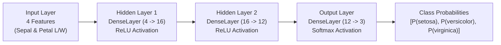
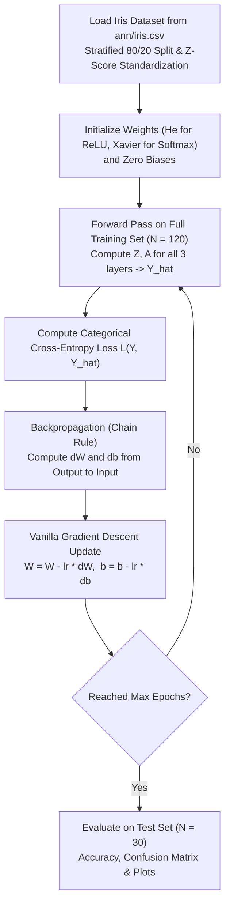

# Artificial Neural Network (ANN) — Laboratory 3, Exercise 1

## 1. Problem Overview

The goal of **Exercise 1** (from `IAI_3.md`) is to implement a simple feedforward neural network from scratch to classify Iris flowers into one of three species based on four morphological measurements:

- **Input Features (4)**: `sepal length`, `sepal width`, `petal length`, `petal width` (in cm).
- **Target Classes (3)**: `Iris-setosa`, `Iris-versicolor`, `Iris-virginica` (50 samples each, 150 samples total).
- **Dataset Source**: Standard UCI Iris dataset stored locally in `ann/iris.csv` (originally fetched from the UCI Machine Learning Repository, `id=53`).

### Task Constraints
- **2 hidden layers**, fully connected (dense).
- **ReLU** activation function in both hidden layers.
- **Softmax** activation function in the output layer.
- **No regularization** (no L1/L2 weight decay, no Dropout).
- **No advanced optimization** (plain vanilla gradient descent — no Momentum, RMSProp, or Adam).
- **No batching** (full-dataset gradient descent per epoch).

---

## 2. Network Architecture & Data Flow

The network is implemented using two modular NumPy classes across `ann/layers.py` and `ann/neural_network.py`:
- **`DenseLayer`** (`ann/layers.py`): Stores all neurons in a layer collectively as a weight matrix $W \in \mathbb{R}^{n_{\text{in}} \times n_{\text{out}}}$ and a bias vector $b \in \mathbb{R}^{1 \times n_{\text{out}}}$, using activation functions from `ann/activations.py`. Column $j$ of $W$ and entry $j$ of $b$ correspond to the weights and bias of neuron $j$.
- **`ArtificialNeuralNetwork`** (`ann/neural_network.py`): Composes three `DenseLayer` instances (`4 -> 16 -> 12 -> 3` by default) and orchestrates forward propagation, categorical cross-entropy loss calculation, analytical backpropagation, and vanilla gradient descent updates.

### Training Pipeline per Epoch

---

## 3. Data Preprocessing (`ann/data_loader.py`)

1. **Stratified 80/20 Train/Test Split**:
   - Each species is split independently so the training set contains exactly **120 samples** (40 per species) and the test set contains **30 samples** (10 per species).
2. **Feature Standardization (Z-Score Normalization)**:
   $$X_{\text{scaled}} = \frac{X - \mu_{\text{train}}}{\sigma_{\text{train}}}$$
   - Mean $\mu_{\text{train}}$ and standard deviation $\sigma_{\text{train}}$ are computed **strictly on the training set** and applied to both train and test sets to prevent data leakage.
   - Centering and scaling features ensures all 4 inputs contribute on a comparable scale, preventing skewed gradients under vanilla gradient descent.
3. **One-Hot Label Encoding**:
   - Class indices $\{0, 1, 2\}$ are converted into one-hot row vectors: e.g., class `1` becomes $[0, 1, 0]$.

---

## 4. Mathematical Formulation

Let $N$ be the number of training samples ($N = 120$), $X \in \mathbb{R}^{N \times 4}$ the input matrix, and $Y \in \{0, 1\}^{N \times 3}$ the one-hot target matrix.

### 4.1. Weight Initialization
- **Hidden layers (ReLU)** use **He initialization**:
  $$W_l \sim \mathcal{N}\!\left(0, \sqrt{\frac{2}{n_{\text{in}}}}\right), \quad b_l = \mathbf{0}$$
  He scaling preserves activation variance through ReLU layers and avoids vanishing/exploding signals or dead neurons at epoch 1.
- **Output layer (Softmax)** uses **Xavier initialization**:
  $$W_3 \sim \mathcal{N}\!\left(0, \sqrt{\frac{1}{n_{\text{in}}}}\right), \quad b_3 = \mathbf{0}$$

### 4.2. Forward Propagation
For each layer $l \in \{1, 2, 3\}$ with input $A_{l-1}$ (where $A_0 = X$):

$$Z_l = A_{l-1} W_l + b_l$$

- **Hidden Layers ($l = 1, 2$) — ReLU**:
  $$A_l = \text{ReLU}(Z_l) = \max(0, Z_l)$$
- **Output Layer ($l = 3$) — Numerically Stable Softmax**:
  $$\hat{Y}_{i,c} = \text{Softmax}(Z_3)_{i,c} = \frac{\exp(Z_{3,i,c} - m_i)}{\sum_{k=1}^{3} \exp(Z_{3,i,k} - m_i)}, \quad m_i = \max_k Z_{3,i,k}$$
  Subtracting the row maximum $m_i$ leaves the mathematical result unchanged while preventing floating-point overflow in $\exp(\cdot)$. Each row of $\hat{Y}$ forms a valid probability distribution summing to $1$.

### 4.3. Loss Function (Categorical Cross-Entropy)
$$L(Y, \hat{Y}) = -\frac{1}{N} \sum_{i=1}^{N} \sum_{c=1}^{3} Y_{i,c} \log(\hat{Y}_{i,c} + \epsilon)$$
where $\epsilon = 10^{-15}$ guards against $\log(0)$.

### 4.4. Backpropagation
Applying the chain rule from output back to input yields remarkably clean matrix gradients:

1. **Output Layer (Softmax + Cross-Entropy combined derivative)**:
   $$dZ_3 = \frac{\partial L}{\partial Z_3} = \frac{1}{N}(\hat{Y} - Y)$$
   $$dW_3 = A_2^T dZ_3, \qquad db_3 = \sum_{i=1}^{N} dZ_{3,i}, \qquad dA_2 = dZ_3 W_3^T$$

2. **Hidden Layer 2 (ReLU)**:
   $$dZ_2 = dA_2 \odot \mathbb{1}(Z_2 > 0)$$
   $$dW_2 = A_1^T dZ_2, \qquad db_2 = \sum_{i=1}^{N} dZ_{2,i}, \qquad dA_1 = dZ_2 W_2^T$$

3. **Hidden Layer 1 (ReLU)**:
   $$dZ_1 = dA_1 \odot \mathbb{1}(Z_1 > 0)$$
   $$dW_1 = X^T dZ_1, \qquad db_1 = \sum_{i=1}^{N} dZ_{1,i}$$

### 4.5. Vanilla Gradient Descent Update
Without optimizers or regularization, parameters are updated directly once per epoch using the full training set:

$$W_l \leftarrow W_l - \eta \, dW_l, \qquad b_l \leftarrow b_l - \eta \, db_l$$

### 4.6. Numerical Gradient Check Verification
To verify that every analytical derivative in `DenseLayer.backward()` and `ArtificialNeuralNetwork.backward()` is exact, `numerical_gradient_check()` compares all analytical gradients against centered finite differences:
$$\frac{\partial L}{\partial \theta} \approx \frac{L(\theta + \epsilon) - L(\theta - \epsilon)}{2\epsilon}, \quad \epsilon = 10^{-5}$$
- **Result**: Maximum relative error across all weights and biases = **`1.974e-08` (`PASSED`)**.
- *(Note: Small non-zero biases `0.05` are used during the check so no pre-activation sits exactly on the non-differentiable ReLU kink at $z = 0$.)*

---

## 5. ANN Parameters & Hyperparameters

### 5.1. Configuration & Hyperparameters

| Parameter | Where Defined | Default | Tested Values | Description & Role |
| :--- | :--- | :---: | :--- | :--- |
| `input_size` | `ArtificialNeuralNetwork`, `DenseLayer` | `4` | Fixed (`4`) | Number of input features per sample (`sepal length`, `sepal width`, `petal length`, `petal width`). Sets the row dimension of the first weight matrix $W_1$. |
| `hidden_layer_sizes` | `ArtificialNeuralNetwork` | `(16, 12)` | `(4, 4)`, `(8, 6)`, `(16, 12)`, `(32, 16)`, `(64, 32)` | Tuple `(h1, h2)` giving the number of neurons in Hidden Layer 1 and Hidden Layer 2. Controls model capacity: too small risks underfitting or dying ReLUs; too large risks overfitting without regularization. |
| `output_size` | `ArtificialNeuralNetwork`, `DenseLayer` | `3` | Fixed (`3`) | Number of neurons in the output layer, matching the 3 Iris classes (`Iris-setosa`, `Iris-versicolor`, `Iris-virginica`). |
| `activation` | `DenseLayer` | `"relu"` / `"softmax"` | Fixed by spec | Activation function applied after $Z = XW + b$. Hidden layers use **ReLU** for non-linear feature learning; the output layer uses **Softmax** to produce class probabilities summing to 1. |
| `learning_rate` ($\eta$) | `ArtificialNeuralNetwork` | `0.05` | `0.005`, `0.01`, `0.05`, `0.1`, `0.5` | Step size controlling how much weights and biases move in the opposite direction of the gradient each epoch. Too small converges slowly; too large causes oscillations or overconfident predictions. |
| `epochs` | `ArtificialNeuralNetwork` | `1000` | `100`, `300`, `500`, `1000`, `2000` | Total number of training iterations. Because there is no batching, each epoch performs one full-dataset forward pass, one backward pass, and one gradient update across all 120 training samples. |
| `seed` | `ArtificialNeuralNetwork`, `load_iris_data` | `None` (`42` in `main.py`) | `100..109` (10 runs) | Optional seed for NumPy's random generator (`np.random.default_rng`). Makes random weight initialization and stratified shuffling reproducible across runs. |
| `test_size` | `load_iris_data` | `0.2` | Fixed (`0.2`) | Fraction of each class reserved for evaluation (20% = 10 test samples and 40 training samples per species). |
| `standardize` | `load_iris_data` | `True` | `True`, `False` | Toggles z-score feature normalization using training-set mean and standard deviation. Prevents features with larger numeric ranges from dominating vanilla gradient descent updates. |

### 5.2. Trainable Parameters (Learned by the Network)

Inside each `DenseLayer`, two parameter arrays are automatically learned via backpropagation and gradient descent:
- **Weight matrix `W`** (shape `input_size × output_size`): Column `j` stores the incoming connection weights of neuron `j`. Initialized randomly (He for ReLU, Xavier for Softmax) to break symmetry so neurons learn distinct features.
- **Bias vector `b`** (shape `1 × output_size`): Entry `j` stores the learnable offset for neuron `j`, allowing its activation threshold to shift independently of the origin. Initialized to zeros.

For the default `4 -> 16 -> 12 -> 3` architecture, the total number of trainable parameters is **323**:
- Hidden Layer 1 (`4 -> 16`): $4 \times 16 + 16 = 80$
- Hidden Layer 2 (`16 -> 12`): $16 \times 12 + 12 = 204$
- Output Layer (`12 -> 3`): $12 \times 3 + 3 = 39$

---

## 6. Default Run Results

Running `python ann/main.py` with the baseline configuration (`hidden_layer_sizes=(16, 12)`, `learning_rate=0.05`, `epochs=1000`, `standardize=True`, `seed=42`):

- **Final Train Loss**: `0.0480` | **Train Accuracy**: **`98.33%`** (118 / 120)
- **Final Test Loss**: `0.2153` | **Test Accuracy**: **`96.67%`** (29 / 30)
- **Training Time**: `93.66 ms`

### Test Set Confusion Matrix & Per-Class Metrics

| True \ Predicted | `setosa` | `versicolor` | `virginica` | Precision | Recall | F1-Score | Support |
| :--- | :---: | :---: | :---: | :---: | :---: | :---: | :---: |
| **`Iris-setosa`** | **10** | 0 | 0 | 1.0000 | 1.0000 | 1.0000 | 10 |
| **`Iris-versicolor`** | 0 | **10** | 0 | 0.9091 | 1.0000 | 0.9524 | 10 |
| **`Iris-virginica`** | 0 | 1 | **9** | 1.0000 | 0.9000 | 0.9474 | 10 |

- `Iris-setosa` is linearly separable and classified with **100% precision and recall**.
- The single error occurs on the overlapping boundary between `Iris-versicolor` and `Iris-virginica` (which is well known in the Iris dataset).

*Visualizations generated in `ann/plots/`*:
- `default_training_curves.png` — Training vs. test cross-entropy loss and accuracy over 1000 epochs.
- `default_confusion_matrix.png` — Annotated test-set confusion matrix heatmap.

---

## 7. Parameter Study & Experimental Analysis

All parameter configurations were evaluated over **10 independent runs** (`seeds = 100..109`, each with its own stratified 80/20 split and weight initialization). Baseline parameters unless varied:
- `hidden_layer_sizes = (16, 12)`, `learning_rate = 0.05`, `epochs = 1000`, `standardize = True`.

Full numerical results are saved in `ann/ann_experiment_results.xlsx`, and averaged comparison curves are saved in `ann/plots/param_*.png`.

### 7.1. Summary Table

| Experiment Group | Parameter | Value | Avg Train Acc | Avg Test Acc | Best / Worst Test Acc | Avg Train Loss | Avg Test Loss | Avg Time (ms) |
| :--- | :--- | :--- | :---: | :---: | :---: | :---: | :---: | :---: |
| **Hidden Layer Architecture** | `hidden_layer_sizes` | `(4, 4)` | 95.92% | 92.00% | 100.00% / 80.00% | 0.1022 | 0.1984 | 80.15 |
| | | `(8, 6)` | 97.83% | **95.33%** | 100.00% / 90.00% | 0.0518 | **0.1203** | 83.31 |
| | | `(16, 12)` | 98.83% | 94.67% | 100.00% / 90.00% | 0.0364 | 0.1367 | 91.78 |
| | | `(32, 16)` | 98.83% | 94.33% | 96.67% / 86.67% | 0.0334 | 0.1588 | 104.70 |
| | | `(64, 32)` | 99.08% | 94.33% | 100.00% / 86.67% | 0.0289 | 0.1561 | 137.94 |
| **Learning Rate** | `learning_rate` | `0.005` | 90.92% | 90.00% | 96.67% / 76.67% | 0.2594 | 0.2937 | 92.42 |
| | | `0.01` | 96.33% | 93.67% | 100.00% / 86.67% | 0.1531 | 0.2007 | 91.23 |
| | | `0.05` | 98.83% | 94.67% | 100.00% / 90.00% | 0.0364 | **0.1367** | 93.74 |
| | | `0.1` | 99.08% | 94.67% | 100.00% / 90.00% | 0.0235 | 0.1788 | 93.43 |
| | | `0.5` | 100.00% | **95.33%** | 100.00% / 90.00% | 0.0022 | 0.4224 | 92.14 |
| **Number of Epochs** | `epochs` | `100` | 90.92% | 89.67% | 96.67% / 76.67% | 0.2600 | 0.2942 | 9.55 |
| | | `300` | 97.00% | 93.33% | 100.00% / 86.67% | 0.1028 | 0.1618 | 27.61 |
| | | `500` | 98.00% | 94.00% | 100.00% / 90.00% | 0.0622 | **0.1367** | 45.50 |
| | | `1000` | 98.83% | **94.67%** | 100.00% / 90.00% | 0.0364 | **0.1367** | 92.08 |
| | | `2000` | 99.08% | **94.67%** | 100.00% / 90.00% | 0.0235 | 0.1780 | 187.69 |
| **Feature Standardization** | `standardize` | `True` | 98.83% | **94.67%** | 100.00% / **90.00%** | 0.0364 | 0.1367 | 91.31 |
| | | `False` | 95.75% | 94.00% | 100.00% / 66.67% | 0.1141 | 0.1356 | 93.97 |

### 7.2. Key Observations

1. **Hidden Layer Size (Capacity vs. Overfitting)**:
   - Very small layers `(4, 4)` occasionally suffer from limited capacity or dying ReLUs (worst test accuracy drops to `80.00%`, avg `92.00%`).
   - Compact hidden layers `(8, 6)` and `(16, 12)` strike the best balance on a 120-sample dataset, achieving **94.67%–95.33%** average test accuracy and the lowest test cross-entropy loss (`0.1203–0.1367`).
   - Larger networks `(32, 16)` and `(64, 32)` drive training loss down to `0.0289` (`99.08%` train acc), but test loss climbs to `0.1561–0.1588` — classic mild overfitting when no regularization is applied.

2. **Learning Rate ($\eta$)**:
   - Too small (`0.005`, `0.01`): convergence is slow within 1000 epochs, leaving test loss high (`0.2937` and `0.2007`).
   - Moderate (`0.05`): optimal trade-off between convergence speed and calibration (`94.67%` test accuracy, lowest test loss `0.1367`).
   - Large (`0.5`): pushes training accuracy to `100.00%` (`0.0022` train loss), producing sharp, overconfident softmax probabilities; as a result, any single misclassified test point near the versicolor/virginica boundary incurs a severe cross-entropy penalty, driving mean test loss up to `0.4224` (clearly visible as the U-shaped curve in `plots/param_learning_rate.png`).

3. **Training Epochs**:
   - Rapid gains occur in the first 300–500 epochs (`89.67% -> 94.00%`).
   - Between `500` and `1000` epochs, test loss bottoms out at `0.1367` while test accuracy reaches `94.67%`.
   - Extending to `2000` epochs yields no further test accuracy gain while test loss increases to `0.1780` due to overfitting without regularization.

4. **Feature Standardization**:
   - Standardizing inputs significantly improves training stability and worst-case generalization: worst-case test accuracy jumps from **`66.67%` (unscaled)** to **`90.00%` (standardized)**, and average training accuracy increases from `95.75%` to `98.83%`.

---

## 8. Project Files

- `ann/activations.py` — `relu`, `relu_derivative`, and numerically stable `softmax` activation functions.
- `ann/layers.py` — `DenseLayer` class (He/Xavier initialization, forward pass, backward pass, vanilla GD update).
- `ann/neural_network.py` — `ArtificialNeuralNetwork` class composing 2 ReLU hidden layers + Softmax output layer and full-dataset training loop.
- `ann/evaluation.py` — `compute_confusion_matrix`, `compute_classification_metrics`, and `numerical_gradient_check`.
- `ann/iris.csv` — Standard 150-sample UCI Iris dataset.
- `ann/data_loader.py` — Loads `ann/iris.csv`, splits stratified 80/20, standardizes features, and one-hot encodes labels.
- `ann/plotter.py` — Generates training curves, confusion matrix heatmap, and parameter comparison plots.
- `ann/experiments.py` — Multi-run parameter study and Excel exporter (`ann_experiment_results.xlsx`).
- `ann/main.py` — Runs gradient check, trains default model, prints metrics/predictions, and executes the full parameter study.
- `ann/plots/` — All saved PNG visualizations.
