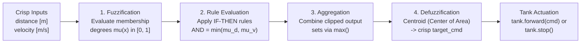

# Fuzzy Inference System (FIS) — Laboratory 4, Exercise 1

## 1. Problem Overview

The goal of **Exercise 1** (from `fis/IAI_4.md`) is to implement a **Fuzzy Inference System (FIS)** using the `scikit-fuzzy` library that controls a simulated tank in **V-REP / CoppeliaSim** (scene `fis/car_and_building.ttt`) so that it approaches a wall and **stops safely before colliding with it**.

### Inputs & Output
- **Input 1 — Distance (`distance`)**: Forward distance to the wall measured in meters by the front proximity sensor (`Proximity_sensor`).
- **Input 2 — Velocity (`velocity`)**: Current planar linear speed of the tank in $\text{m/s}$, read via `vrep.simxGetObjectVelocity`.
- **Output — Target Drive Command (`target_cmd`)**: Continuous velocity command passed to `tank.forward(cmd)` (or triggering `tank.stop()` when `target_cmd <= 0.4`).

### Scene Measurements (`fis/ex1/inspect_scene.py`)
Before designing the fuzzy sets, the physical characteristics of `car_and_building.ttt` were measured directly:
- **Initial distance to wall**: $\approx 7.2\text{ m}$ (within sensor range from the start).
- **Maximum linear speed** (at `tank.forward(10)`): $\approx 0.70\text{–}0.84\text{ m/s}$ (cruise $\approx 0.70\text{ m/s}$).
- **Braking behavior** (`tank.stop()` from $0.73\text{ m/s}$): full stop in $\approx 0.5\text{ s}$ over $\approx 0.10\text{ m}$, with minor suspension pitch oscillations of $2\text{–}5\text{ cm}$.

---

## 2. What Are Fuzzy Sets and Fuzzy Inference Systems?

### 2.1. Classical (Crisp) Sets vs. Fuzzy Sets
In classical (Boolean) set theory, an element $x$ either belongs completely to a set $A$ or does not belong at all:
$$\chi_A(x) \in \{0, 1\}$$
For example, a crisp rule like *"if distance < 1.5 m, then stop"* creates an abrupt discontinuity: at $1.51\text{ m}$ the tank runs at full speed, and at $1.49\text{ m}$ it slams the brakes.

**Fuzzy set theory** (introduced by Lotfi Zadeh, 1965) generalizes membership to a continuous degree in $[0, 1]$ via a **membership function** $\mu_A(x)$:
$$\mu_A : X \rightarrow [0, 1]$$
A single numeric measurement — for instance, `distance = 2.6 m` — can simultaneously belong to `close` with degree $\mu_{\text{close}}(2.6) = 0.33$ and to `medium` with degree $\mu_{\text{medium}}(2.6) = 0.22$. This enables smooth, human-like reasoning and gradual deceleration.

### 2.2. Mamdani FIS Pipeline
`scikit-fuzzy`'s `skfuzzy.control` module implements a **Mamdani Fuzzy Inference System**, which maps crisp sensor readings to a crisp control command in four stages:



1. **Fuzzification**: Convert crisp inputs `(distance, velocity)` into membership degrees across all linguistic terms (e.g., `close`, `medium`, `fast`).
2. **Rule Evaluation (Inference)**: Evaluate each `IF ... AND ... THEN ...` rule. In Mamdani inference, the logical `AND` (`&`) uses the **minimum** operator ($\min(\mu_A(d), \mu_B(v))$), which clips (truncates) the consequent fuzzy set to that firing strength.
3. **Aggregation**: Combine all clipped consequent fuzzy sets into a single output membership curve $\mu_{\text{out}}(y)$ using the **maximum** operator.
4. **Defuzzification (Centroid / Center of Gravity)**: Convert the aggregated fuzzy shape back into a single crisp number:
   $$y^* = \frac{\sum_{i} y_i \, \mu_{\text{out}}(y_i)}{\sum_{i} \mu_{\text{out}}(y_i)}$$

---

## 3. Linguistic Variables & Membership Functions

The controller uses two standard piecewise-linear membership function shapes:

- **Triangular (`trimf(x, [a, b, c])`)** — used for interior linguistic terms with a single peak at $b$:
  $$\mu_{\text{tri}}(x; a, b, c) = \max\!\left(\min\!\left(\frac{x - a}{b - a},\; \frac{c - x}{c - b}\right),\; 0\right)$$
- **Trapezoidal (`trapmf(x, [a, b, c, d])`)** — used for boundary terms (`very_close`, `far`, `slow`, `fast`) that should saturate at $\mu = 1$ over an entire plateau $[b, c]$:
  $$\mu_{\text{trap}}(x; a, b, c, d) = \max\!\left(\min\!\left(\frac{x - a}{b - a},\; 1,\; \frac{d - x}{d - c}\right),\; 0\right)$$

### 3.1. Variable Definitions (`BrakingFuzzyController._define_variables`)

| Variable | Role | Universe | Term | Shape & Parameters | Meaning & Design Rationale |
| :--- | :---: | :---: | :--- | :--- | :--- |
| `distance` | Input | $[0.0, 10.0]$ m (step `0.05`) | `very_close` | `trapmf([0.0, 0.0, 0.5, 1.2])` | Full stop zone below $0.5\text{ m}$, fading out by $1.2\text{ m}$. |
| | | | `close` | `trimf([0.6, 1.8, 3.0])` | Near-wall zone where the tank must creep or stop depending on speed. |
| | | | `medium` | `trimf([2.2, 4.0, 5.8])` | Transition zone for early deceleration when approaching fast. |
| | | | `far` | `trapmf([4.8, 6.2, 10.0, 10.0])` | Safe open distance; allows full-speed approach. |
| `velocity` | Input | $[0.0, 1.2]$ m/s (step `0.02`) | `slow` | `trapmf([0.0, 0.0, 0.15, 0.35])` | Low speed ($\le 0.15\text{ m/s}$ fully slow, transitioning up to $0.35\text{ m/s}$). |
| | | | `medium` | `trimf([0.20, 0.45, 0.70])` | Moderate cruising speed. |
| | | | `fast` | `trapmf([0.55, 0.75, 1.2, 1.2])` | High speed (matches measured max speed $\approx 0.70\text{–}0.84\text{ m/s}$). |
| `target_cmd` | Output | $[-1.0, 10.0]$ (step `0.1`) | `stop` | `trimf([-1.0, 0.0, 1.0])` | Symmetric around $0.0$ so its centroid is **exactly `0.0`**. |
| | | | `creep` | `trimf([0.5, 2.0, 4.0])` | Gentle crawl toward the wall (centroid $\approx 2.1$). |
| | | | `medium` | `trimf([3.0, 5.5, 8.0])` | Moderate forward drive (centroid $= 5.5$). |
| | | | `fast` | `trapmf([7.0, 8.5, 10.0, 10.0])` | Near-maximum forward drive (centroid $\approx 8.9$). |

### Why Neighboring Terms Overlap
Adjacent membership functions intentionally overlap (e.g., `very_close` ends at $1.2\text{ m}$ while `close` starts at $0.6\text{ m}$). Overlap guarantees:
1. **No dead zones**: every valid input activates at least one rule.
2. **Smooth transitions**: the defuzzified command changes continuously as the tank approaches the wall instead of jumping abruptly.

### Why `target_cmd` Starts at `-1.0`
With centroid defuzzification over $[0, 10]$, a triangle `[0, 0, 1]` would have a centroid at $0.33$ instead of $0.0$. Extending the output universe slightly to $[-1.0, 10.0]$ and defining `stop` as `trimf([-1.0, 0.0, 1.0])` places its center of gravity cleanly at `0.0`.

---

## 4. Fuzzy Rule Base (`BrakingFuzzyController._define_rules`)

All $4 \times 3 = 12$ combinations of `(distance, velocity)` are explicitly covered so the inference engine never encounters an unhandled state:

| `distance` \ `velocity` | `slow` | `medium` | `fast` |
| :--- | :---: | :---: | :---: |
| **`far`** | `fast` | `fast` | `fast` |
| **`medium`** | `medium` | `medium` | **`creep`** |
| **`close`** | `creep` | **`stop`** | **`stop`** |
| **`very_close`** | **`stop`** | **`stop`** | **`stop`** |

### Key Control Behaviors Encoded in the Rules
- **Far from the wall**: regardless of current velocity, command `fast` to accelerate toward the wall.
- **Velocity-aware deceleration**: at `medium` distance, a `slow` or `medium`-speed tank keeps a `medium` command, whereas a `fast` tank is immediately pulled down to `creep` to shed momentum early.
- **Safety braking**: at `close` distance, only a `slow` tank is allowed to `creep` closer; if it arrives at `medium` or `fast` speed, the controller commands `stop`.
- **Hard stop zone**: once `very_close`, all velocities map to `stop`.

---

## 5. Code Architecture & Walkthrough

The Exercise 1 implementation is organized under `fis/ex1/`, while shared simulator files remain in `fis/`:

```text
fis/
├── ex1/
│   ├── fuzzy_controller.py      # BrakingFuzzyController class (FIS + plotting)
│   ├── run.py                   # CoppeliaSim connection & real-time control loop
│   ├── inspect_scene.py         # Diagnostic script for measuring sensor & velocity ranges
│   └── FIS_ex1_explanation.md   # This documentation
├── car_and_building.ttt         # Exercise 1 CoppeliaSim scene
├── tank.py                      # Tank actuator wrapper (forward, backward, stop, ...)
├── vrep.py / vrepConst.py       # Legacy Remote API Python bindings
└── remoteApi.dll                # 64-bit Legacy Remote API native library
```

### 5.1. `fis/ex1/fuzzy_controller.py` — `BrakingFuzzyController`
- **`__init__(max_dist=10.0, max_vel=1.2)`**: Builds the antecedents/consequent (`_define_variables()`), the 12-rule base (`_define_rules()`), compiles `ctrl.ControlSystem`, and creates a reusable `ctrl.ControlSystemSimulation` instance.
- **`compute(distance, velocity) -> float`**: Clips inputs to `[0, max_dist]` and `[0, max_vel]` (preventing out-of-range errors from sensor spikes), runs Mamdani inference (`self.sim.compute()`), and returns the crisp `target_cmd`.
- **`plot(save_path=None, show=True)`**: Renders a 3-panel Matplotlib figure displaying all membership functions for `distance`, `velocity`, and `target_cmd`. Running the file directly executes this plot and saves `fis/ex1/membership_functions.png` without needing CoppeliaSim open.

### 5.2. `fis/ex1/run.py` — Real-Time Control Loop
1. **Path & DLL Setup**: Sets the working directory to `fis/` (`os.chdir(FIS_DIR)`) so `vrep.py` can locate `remoteApi.dll`, and adds both `fis/ex1/` and `fis/` to `sys.path`.
2. **Streaming Initialization**: Connects on `127.0.0.1:19999`, resolves the `Proximity_sensor` handle, and initiates asynchronous streaming (`simx_opmode_streaming`) for both `simxReadProximitySensor` and `simxGetObjectVelocity` (using `tank.left_back_handle`), waiting `0.2 s` for the buffer to populate.
3. **Control Loop (10 Hz, `time.sleep(0.1)`)**:
   - Reads planar linear velocity $v = \sqrt{v_x^2 + v_y^2}$ via `simx_opmode_buffer`.
   - Reads the proximity sensor via `simx_opmode_buffer`. When `detected` is `False`, substitutes `controller.max_dist` (avoiding the V-REP pitfall where an undetected `detectedPoint` equals `[0, 0, 0]`).
   - Calls `cmd = controller.compute(distance=dist, velocity=speed)`.
   - If `cmd <= STOP_CMD_THRESHOLD` (`0.4`), calls `tank.stop()`; otherwise calls `tank.forward(cmd)`.
   - Once the tank remains stopped (`speed < 0.04 m/s`) near the wall (`dist < 1.5 m`) for 5 consecutive ticks, exits cleanly.
4. **Safe Shutdown**: A `finally:` block always calls `tank.stop()` and `vrep.simxFinish(clientID)` even on `Ctrl+C`.

---

## 6. Observed Results & How to Run

### Test Run Summary (`car_and_building.ttt`)
- The tank accelerated smoothly from `~7.2 m`, began decelerating progressively as `distance` entered `medium` and `close`, crept slowly down below `1.0 m`, and triggered `STOP` at `fis_cmd <= 0.4`.
- **Final stopping distance**: **`0.66 m`** in front of the wall (`v = 0.01 m/s`), with zero collision.

### Commands
- **View and save membership function plots** (no simulator required):
  ```powershell
  python fis/ex1/fuzzy_controller.py
  ```
- **Run the Exercise 1 fuzzy braking controller** (with `car_and_building.ttt` open and playing in CoppeliaSim):
  ```powershell
  python fis/ex1/run.py
  ```
- **Re-run the raw sensor/braking diagnostic**:
  ```powershell
  python fis/ex1/inspect_scene.py
  ```
