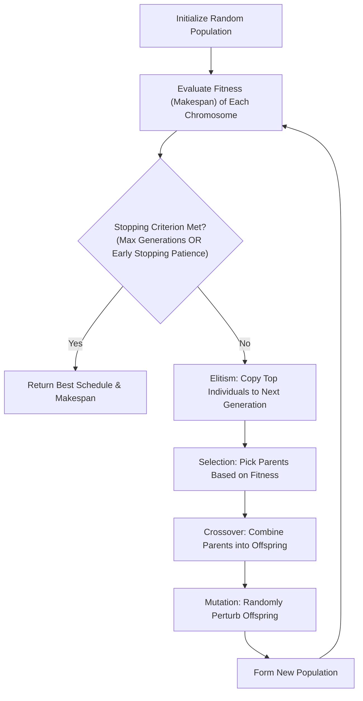

# Genetic Algorithm for Job-Shop Scheduling Problem (JSSP)

## 1. Problem Overview & Excel File Structure

The goal of **Exercise 1** is to schedule a set of jobs (tasks) across available resources (machines) so that the **total time to finish all tasks (makespan, $C_{\max}$)** is minimized.

### How `GA_task.xlsx` Is Structured (Columns, Rows, and Resources)
The spreadsheet has **13 rows** and **100 columns** (`A` to `CV`):
- **Columns = Tasks (1 to 50)**: Each task takes up **2 consecutive columns**:
  - The first column (`R`) is the **Resource ID** (`1` to `10`) required for that step.
  - The second column (`T`) is the **Time (Duration)** needed on that resource for that step.
  - For example, **Columns A & B** belong to **Task 1**, **Columns C & D** belong to **Task 2**, ..., and **Columns CU & CV** belong to **Task 50**.
- **Rows = Sequential Operations within Each Task (1 to 11)**:
  - **Row 1**: Task numbers (`1, 2, 3, ..., 50`).
  - **Row 2**: Sub-headers (`R, T, R, T, ...`).
  - **Rows 3 to 13**: The **11 sequential operations** that every task must go through from top to bottom.

```text
Excel Layout Example (First 3 Tasks, First 4 Operations):
+---------------+---------------+---------------+---------------+
|               |    Task 1     |    Task 2     |    Task 3     |  <-- Row 1 (Task ID)
|               |  Col A  Col B |  Col C  Col D |  Col E  Col F |
|               |   R       T   |   R       T   |   R       T   |  <-- Row 2 (Headers)
+---------------+-------+-------+-------+-------+-------+-------+
| Row 3  (Op 1) |   9      22   |   5      17   |   5      24   |
| Row 4  (Op 2) |   3      49   |  10      13   |   4      28   |
| Row 5  (Op 3) |   1      47   |   7      23   |   1      18   |
| Row 6  (Op 4) |   9      30   |   4      29   |   5      32   |
| ...           |  ...     ...  |  ...     ...  |  ...     ...  |
| Row 13 (Op11) |   5      46   |   7      13   |   1      26   |
+---------------+-------+-------+-------+-------+-------+-------+
```

### How Resources Work
Think of **Resources (`1` to `10`)** as 10 physical machines or workstations in a factory, and **Tasks (`1` to `50`)** as 50 products being manufactured:
1. **Sequential steps within a task (Top-to-Bottom along a column pair)**:
   - Look at **Task 1** (`Col A` & `Col B`):
     - **Op 1 (Row 3)**: Must first use **Resource 9** for **22** time units.
     - **Op 2 (Row 4)**: Only *after* Op 1 finishes can Task 1 move to **Resource 3** for **49** time units.
     - **Op 3 (Row 5)**: Only *after* Op 2 finishes can Task 1 move to **Resource 1** for **47** time units.
     - *(Notice that in Op 4, Task 1 needs **Resource 9** again for **30** time units — a task can revisit the same resource multiple times during its 11 steps!)*
2. **Resource conflict / queuing across tasks**:
   - Look at **Row 3 (Op 1)** for **Task 2** (`R=5, T=17`) and **Task 3** (`R=5, T=24`).
   - Both Task 2 and Task 3 want **Resource 5** for their very first operation!
   - Because **Resource 5 can only handle one task at a time**, one of them must go first (e.g., Task 2 uses Resource 5 during $[0, 17]$, and Task 3 waits until $t=17$ and runs on Resource 5 during $[17, 41]$).
3. **Why the ordering matters**:
   - The Genetic Algorithm decides **which task gets priority on a resource whenever multiple tasks compete for it**, while strictly respecting each task's top-to-bottom row order (`Row 3 -> Row 4 -> ... -> Row 13`).

### Dataset Summary
- **Number of Tasks ($N_{\text{tasks}}$)**: $50$ (numbered `1` to `50`)
- **Operations per Task ($N_{\text{ops}}$)**: $11$ sequential operations per task ($550$ operations in total)
- **Number of Resources ($N_{\text{res}}$)**: $10$ (numbered `1` to `10`)
- **Operation Durations ($T$)**: Between $10$ and $50$ time units

| Resource ID | `1` | `2` | `3` | `4` | `5` | `6` | **`7`** | `8` | `9` | `10` |
| :--- | :---: | :---: | :---: | :---: | :---: | :---: | :---: | :---: | :---: | :---: |
| **Total Workload ($\sum T$)** | 1698 | 1544 | 1758 | 1503 | 1427 | 1375 | **2073** | 1451 | 1205 | 1589 |

- **Theoretical Lower Bound ($2073$)**: Because **Resource 7** has $2073$ total time units of work across all 50 tasks and can only run one operation at a time, **no schedule can possibly finish in less than $2073$ time units**. If a schedule achieves $C_{\max} = 2073$, it is provably globally optimal ($0\%$ idle time on the bottleneck resource).

### Constraints
1. **Precedence Constraint**: Operations within each task must be executed in their strict predefined order ($O_{j,1} \rightarrow O_{j,2} \rightarrow \dots \rightarrow O_{j,11}$). Operation $k+1$ of task $j$ cannot start until operation $k$ of task $j$ has finished.
2. **Resource Capacity Constraint**: Each resource can process only one operation at any given time.
3. **No Preemption**: Once an operation starts on a resource, it cannot be interrupted until it completes.

### Objective Function (Fitness)
We minimize the **makespan** ($C_{\max}$):
$$C_{\max} = \max_{j \in \{1, \dots, 50\}} C_j$$
where $C_j$ is the completion time of the final (11th) operation of task $j$.

*(Note: Because Resource 7 requires a total of $2073$ time units across all tasks, $2073$ is the theoretical lower bound for $C_{\max}$.)*

---

## 2. What is a Genetic Algorithm (GA)?

A **Genetic Algorithm** is a population-based metaheuristic inspired by Darwinian natural selection and genetics. Instead of searching from a single point, it maintains a population of candidate solutions (**chromosomes**) and evolves them over successive **generations**:



---

## 3. Chromosome & Gene Representation

### Operation-Based Encoding
If we encoded arbitrary start times or operation IDs directly, standard genetic operators would frequently violate the precedence constraint (e.g., scheduling Operation 3 of Task 1 before Operation 2).

To guarantee **100% valid chromosomes**, we use **Operation-Based Representation**:
- **Gene**: A single integer representing a **Task ID** ($j \in \{0, \dots, 49\}$ in 0-based indexing, or $\{1, \dots, 50\}$).
- **Chromosome**: A list of length $50 \times 11 = 550$, where **each Task ID appears exactly 11 times**.

### Decoding a Chromosome into a Schedule
We scan the chromosome from left to right:
- The **1st** occurrence of Task $j$ corresponds to **Operation 1** of Task $j$.
- The **$k$-th** occurrence of Task $j$ corresponds to **Operation $k$** of Task $j$.

For each gene (Task $j$, current operation $k$, requiring resource $R_{j,k}$ for duration $T_{j,k}$):
1. Look up when Task $j$'s previous operation finished: $\text{task\_ready}[j]$.
2. Find the earliest available time slot on resource $R_{j,k}$ that starts at or after $\text{task\_ready}[j]$ and lasts for $T_{j,k}$:
   - **Standard (Semi-Active) Decoding**:
     $$\text{start}_{j,k} = \max(\text{task\_ready}[j], \text{resource\_ready}[R_{j,k}])$$
   - **Active (Gap-Filling) Decoding**: Checks if resource $R_{j,k}$ has an idle gap $[t_{\text{gap\_start}}, t_{\text{gap\_end}}]$ before its last scheduled operation where $\max(\text{task\_ready}[j], t_{\text{gap\_start}}) + T_{j,k} \le t_{\text{gap\_end}}$. If such a gap exists, the operation is inserted into the earliest valid gap; otherwise, it is placed at the end of the resource queue.
3. Set $\text{end}_{j,k} = \text{start}_{j,k} + T_{j,k}$ and update both $\text{task\_ready}[j]$ and the schedule of resource $R_{j,k}$.

After all 550 genes are processed, the makespan is $\max_j \text{task\_ready}[j]$.

---

## 4. Genetic Operators Implemented

### 4.1. Selection Operators
Selection chooses parents from the current population, favoring chromosomes with lower makespan:

1. **Tournament Selection**:
   - Randomly sample $k$ individuals (tournament size, e.g., $k=3$ or $k=5$) from the population.
   - Return the individual with the lowest makespan among the $k$ candidates.
   - *Effect of $k$*: Larger $k$ increases selection pressure (faster convergence, higher risk of premature convergence); smaller $k$ preserves diversity.
2. **Roulette Wheel (Fitness-Proportionate) Selection**:
   - Converts minimization cost $C_i$ into maximization fitness score $f_i = \frac{1}{C_i}$ (or shifted inverse).
   - Selects individual $i$ with probability $p_i = \frac{f_i}{\sum_m f_m}$.
3. **Elitism**:
   - The top $E$ best chromosomes from the current generation are copied unchanged into the next generation so the best solution found so far is never lost.

---

### 4.2. Crossover Operators
Because every valid chromosome must contain each Task ID **exactly 11 times**, standard 1-point or 2-point crossover cannot be used directly. We implement two specialized JSSP crossover methods:

#### A. POX / JOX (Precedence Preservative / Job-Based Order Crossover)
Splits the set of tasks into two random disjoint subsets (`Group A` and `Group B`):
1. Randomly assign each Task ID to `Group A` (with probability $0.5$) or `Group B`.
2. **Inherit from Parent 1**: Copy all genes belonging to `Group A` from Parent 1 into the Child at their **exact indices**.
3. **Inherit from Parent 2**: Fill the remaining empty positions in the Child using the genes belonging to `Group B`, in the **exact left-to-right order** they appear in Parent 2.

```text
Example (3 Tasks, 2 Operations each; Group A = {1, 3}, Group B = {2}):
Parent 1:  [ 2,  1,  2,  3,  1,  3 ]
Parent 2:  [ 3,  2,  1,  3,  2,  1 ]

Step 1 (Keep {1, 3} from Parent 1 in place):
Child:     [ _,  1,  _,  3,  1,  3 ]

Step 2 (Fill blanks with {2} from Parent 2 in order):
Child:     [ 2,  1,  2,  3,  1,  3 ]
```

#### B. Generalized Order Crossover (OX)
Preserves a contiguous sub-schedule from Parent 1 and fills the remaining operations in the relative order of Parent 2:
1. Pick two random cut indices: $\text{start} < \text{end}$.
2. Copy the slice `Parent 1[start:end]` directly into `Child[start:end]`.
3. Count how many times each Task ID appears in that copied slice.
4. Scan `Parent 2` from left to right: for each gene, if the Child still needs more copies of that Task ID (up to 11 total), place it into the next available empty slot of the Child.

```text
Example (cut from index 1 to 4):
Parent 1:  [ 2, | 1,  2,  3, | 1,  3 ]
Parent 2:  [ 3, | 2,  1,  3, | 2,  1 ]

Step 1 (Copy slice [1, 2, 3] from Parent 1):
Child:     [ _, | 1,  2,  3, | _,  _ ]

Step 2 (Remaining needed counts: one '1', one '2', one '3'; scan Parent 2):
Child:     [ 3, | 1,  2,  3, | 2,  1 ]
```

---

### 4.3. Mutation Operators
Mutation introduces random diversity to escape local optima. Since any permutation of the chromosome is valid, permutation mutations preserve feasibility:

1. **Swap Mutation**:
   - Pick two random indices $i \neq j$ in the chromosome and swap `chromosome[i]` and `chromosome[j]`.
2. **Inversion Mutation**:
   - Pick two random indices $i < j$ and reverse the sub-segment `chromosome[i:j+1]`.

---

## 5. Summary of Tunable Parameters

| Parameter | Description | Typical Values to Test |
| :--- | :--- | :--- |
| `pop_size` | Number of individuals in the population | `30`, `50`, `100`, `200` |
| `generations` | Number of evolutionary iterations | `100`, `200`, `500` |
| `crossover_prob` ($p_c$) | Probability of applying crossover to a parent pair | `0.6`, `0.8`, `0.95` |
| `mutation_prob` ($p_m$) | Probability of mutating an offspring chromosome | `0.05`, `0.1`, `0.2`, `0.4` |
| `crossover_type` | Crossover method | `"pox"`, `"ox"` |
| `mutation_type` | Mutation method | `"swap"`, `"inversion"` |
| `selection_type` | Parent selection method | `"tournament"`, `"roulette"` |
| `tournament_size` | Number of candidates per tournament | `2`, `3`, `5`, `7` |
| `elitism_count` | Number of top individuals preserved unchanged | `1`, `2`, `5` |
| `max_no_improvement` | Early stopping patience: stop if best makespan doesn't improve for $M$ generations (`None` to disable) | `25`, `50`, `100`, `None` |

---

## 6. Experimental Results & Parameter Analysis

### 6.1. Results for Interpretation 1: 11 Tasks $\times$ 50 Operations (Each Row = 1 Task)

When each row (`Row 3..13`) is interpreted as a task with 50 sequential operations (`Col 1..50`), each task is a long chain of 50 steps (taking ~1400–1600 time units even by itself), and all 11 tasks compete for the 10 resources.

| Experiment Group | Parameter | Value | Best Makespan | Avg Makespan | Worst Makespan | Avg Generations | Early Stops | Avg Time (s) |
| :--- | :--- | :--- | :---: | :---: | :---: | :---: | :---: | :---: |
| **Population Size** | `pop_size` | `30` | 2843 | 3007.8 | 3106 | 246.4 | 3/5 | 0.55 |
| | `pop_size` | `50` | 2781 | 2821.6 | 2871 | 276.8 | 2/5 | 1.03 |
| | `pop_size` | `100` | 2605 | 2710.4 | 2783 | 298.2 | 1/5 | 2.27 |
| | `pop_size` | `200` | **2540** | **2576.0** | **2628** | 293.6 | 1/5 | 4.46 |
| **Generations Limit** | `generations` | `50` | 2914 | 2978.0 | 3044 | 50.0 | 0/5 | 0.39 |
| | `generations` | `100` | 2779 | 2852.2 | 2956 | 100.0 | 0/5 | 0.76 |
| | `generations` | `200` | 2695 | 2759.8 | 2834 | 194.6 | 1/5 | 1.47 |
| | `generations` | `400` | **2666** | **2724.0** | **2805** | 352.2 | 2/5 | 2.67 |
| **Crossover Probability** | `crossover_prob` | `0.5` | 2683 | 2772.4 | 2937 | 300.0 | 0/5 | 1.88 |
| | `crossover_prob` | `0.7` | 2700 | 2768.0 | 2896 | 280.4 | 1/5 | 1.97 |
| | `crossover_prob` | `0.85` | 2612 | 2684.4 | **2750** | 285.8 | 1/5 | 2.15 |
| | `crossover_prob` | `0.95` | **2578** | **2668.2** | 2783 | 293.0 | 1/5 | 2.35 |
| **Mutation Probability** | `mutation_prob` | `0.02` | 2775 | 2829.8 | 2859 | 229.0 | 3/5 | 1.79 |
| | `mutation_prob` | `0.10` | 2679 | 2716.2 | 2751 | 290.2 | 1/5 | 2.18 |
| | `mutation_prob` | `0.20` | 2671 | **2701.2** | **2745** | 282.0 | 2/5 | 2.15 |
| | `mutation_prob` | `0.40` | **2653** | 2743.0 | 2871 | 300.0 | 0/5 | 2.41 |
| **Crossover Operator** | `crossover_type` | `pox` | **2647** | **2723.0** | **2773** | 300.0 | 0/5 | 2.32 |
| | `crossover_type` | `ox` | 3107 | 3201.4 | 3280 | 201.4 | 4/5 | 1.29 |
| **Mutation Operator** | `mutation_type` | `swap` | 2677 | 2724.6 | **2795** | 300.0 | 0/5 | 2.31 |
| | `mutation_type` | `inversion` | **2610** | **2722.6** | 2819 | 262.4 | 2/5 | 2.03 |
| **Selection Method** | `selection_type` | `tournament` | **2704** | **2739.4** | **2834** | 267.0 | 2/5 | 2.03 |
| | `selection_type` | `roulette` | 2752 | 2829.6 | 2969 | 271.0 | 1/5 | 2.16 |
| **Tournament Size** | `tournament_size` | `2` | 2578 | **2622.0** | **2717** | 300.0 | 0/5 | 2.32 |
| | `tournament_size` | `3` | **2574** | 2682.2 | 2789 | 292.6 | 1/5 | 2.22 |
| | `tournament_size` | `5` | 2711 | 2769.0 | 2829 | 278.0 | 1/5 | 2.09 |
| | `tournament_size` | `7` | 2755 | 2808.8 | 2869 | 300.0 | 0/5 | 2.28 |
| **Early Stopping Patience** | `max_no_improvement` | `25` | 2726 | 2774.0 | 2818 | 186.4 | 5/5 | 1.40 |
| | `max_no_improvement` | `50` | 2674 | 2764.6 | 2825 | 261.8 | 3/5 | 1.99 |
| | `max_no_improvement` | `100` | **2625** | **2693.2** | **2756** | 300.0 | 0/5 | 2.24 |
| | `max_no_improvement` | `None` | 2630 | 2701.2 | 2793 | 300.0 | 0/5 | 2.23 |

---

### 6.2. Results for Interpretation 2: 50 Tasks $\times$ 11 Operations (Each Column Pair = 1 Task)

All experiments were evaluated across **5 runs** using `JobSchedulingGA`. Unless a parameter was being varied, the baseline configuration was:
- `pop_size = 100`, `generations = 300`, `crossover_prob = 0.85`, `mutation_prob = 0.15`, `crossover_type = "pox"`, `mutation_type = "swap"`, `selection_type = "tournament"`, `tournament_size = 3`, `elitism_count = 2`, `max_no_improvement = 60`.

| Experiment Group | Parameter | Value | Best Makespan | Avg Makespan | Worst Makespan | Avg Generations | Early Stops | Avg Time (s) |
| :--- | :--- | :--- | :---: | :---: | :---: | :---: | :---: | :---: |
| **Population Size** | `pop_size` | `30` | 2147 | 2201.4 | 2240 | 224.8 | 4/5 | 0.46 |
| | `pop_size` | `50` | 2099 | 2126.2 | 2149 | 184.4 | 5/5 | 0.64 |
| | `pop_size` | `100` | **2073** | 2107.2 | 2171 | 191.8 | 5/5 | 1.34 |
| | `pop_size` | `200` | **2073** | **2088.2** | **2117** | 142.0 | 5/5 | 2.02 |
| **Generations Limit** | `generations` | `50` | 2117 | 2154.2 | 2189 | 50.0 | 0/5 | 0.36 |
| | `generations` | `100` | 2089 | 2125.0 | 2171 | 100.0 | 0/5 | 0.71 |
| | `generations` | `200` | 2079 | 2111.8 | 2171 | 155.0 | 2/5 | 1.09 |
| | `generations` | `400` | **2073** | **2107.2** | 2171 | 195.2 | 5/5 | 1.36 |
| **Crossover Probability** | `crossover_prob` | `0.5` | 2103 | 2132.0 | 2164 | 230.6 | 4/5 | 1.31 |
| | `crossover_prob` | `0.7` | 2110 | 2129.6 | 2168 | 191.6 | 5/5 | 1.24 |
| | `crossover_prob` | `0.85` | **2073** | 2107.2 | 2171 | 191.8 | 5/5 | 1.35 |
| | `crossover_prob` | `0.95` | **2073** | **2076.2** | **2089** | 166.2 | 5/5 | 1.24 |
| **Mutation Probability** | `mutation_prob` | `0.02` | 2087 | 2124.6 | 2147 | 124.4 | 5/5 | 0.88 |
| | `mutation_prob` | `0.10` | **2073** | **2088.0** | 2106 | 219.4 | 3/5 | 1.54 |
| | `mutation_prob` | `0.20` | **2073** | 2097.0 | 2131 | 163.2 | 5/5 | 1.16 |
| | `mutation_prob` | `0.40` | 2082 | 2095.2 | **2099** | 211.4 | 5/5 | 1.50 |
| **Crossover Operator** | `crossover_type` | `pox` | **2073** | **2107.2** | **2171** | 191.8 | 5/5 | 1.35 |
| | `crossover_type` | `ox` | 2251 | 2294.6 | 2317 | 189.8 | 4/5 | 1.06 |
| **Mutation Operator** | `mutation_type` | `swap` | **2073** | 2107.2 | 2171 | 191.8 | 5/5 | 1.36 |
| | `mutation_type` | `inversion` | **2073** | **2097.8** | **2135** | 144.8 | 5/5 | 1.02 |
| **Selection Method** | `selection_type` | `tournament` | **2073** | 2107.2 | 2171 | 191.8 | 5/5 | 1.35 |
| | `selection_type` | `roulette` | **2073** | **2092.8** | **2126** | 252.2 | 3/5 | 1.78 |
| **Tournament Size** | `tournament_size` | `2` | **2073** | **2091.6** | **2110** | 182.8 | 5/5 | 1.31 |
| | `tournament_size` | `3` | **2073** | 2107.2 | 2171 | 191.8 | 5/5 | 1.36 |
| | `tournament_size` | `5` | 2099 | 2132.2 | 2172 | 137.2 | 5/5 | 0.99 |
| | `tournament_size` | `7` | **2073** | 2109.0 | 2126 | 254.2 | 5/5 | 1.82 |
| **Early Stopping Patience** | `max_no_improvement` | `25` | 2089 | 2111.8 | 2171 | 130.4 | 5/5 | 0.92 |
| | `max_no_improvement` | `50` | **2073** | 2107.2 | 2171 | 183.8 | 5/5 | 1.30 |
| | `max_no_improvement` | `100` | **2073** | **2090.4** | **2110** | 268.4 | 2/5 | 1.88 |
| | `max_no_improvement` | `None` | **2073** | **2090.4** | **2110** | 300.0 | 0/5 | 2.11 |

---

### 6.2. Discussion of Results

1. **Global Optimum Reached ($C_{\max} = 2073$)**:
   - The GA repeatedly finds a schedule with makespan **$2073$**, which equals the theoretical lower bound (the sum of all operation times on bottleneck Resource 7). This means Resource 7 runs continuously from $t=0$ to $t=2073$ with zero idle time.
2. **Crossover Method (`pox` vs `ox`)**:
   - **POX** (`avg = 2107.2`, `best = 2073`) significantly outperforms **OX** (`avg = 2294.6`, `best = 2251`).
   - *Reason*: In JSSP, POX keeps the exact positions and relative ordering of a subset of jobs intact from Parent 1 while interleaving the remaining jobs in Parent 2's exact order. OX cuts a contiguous block of positions, shifting operations outside the cut and disrupting machine-level job ordering across the whole schedule.
3. **Population Size (`pop_size`)**:
   - Small populations (`30`) suffer from premature convergence (`avg = 2201.4`).
   - Increasing `pop_size` to `100` or `200` provides enough genetic diversity to reach the global optimum `2073`, with `pop_size = 200` achieving `avg = 2088.2` in fewer generations (`142.0` on average).
4. **Crossover & Mutation Probabilities**:
   - High crossover probability (`0.85 - 0.95`) works best (`avg = 2076.2` at `p_c = 0.95`).
   - Very low mutation (`0.02`) leads to early stagnation (`124.4` gens, `avg = 2124.6`), whereas moderate mutation (`0.10 - 0.20`) maintains diversity and reaches `2073`.
5. **Selection Pressure (`tournament_size` & `selection_type`)**:
   - Mild selection pressure (`tournament_size = 2` or shifted `roulette`) achieves better average makespans (`2091.6` and `2092.8`) than high tournament size (`k = 5`, `avg = 2132.2`), which causes premature loss of diversity.
6. **Early Stopping (`max_no_improvement`)**:
   - A small patience (`25`) stops too early before escaping plateaus (`best = 2089`).
   - A patience of `60 - 100` generations achieves the exact same final solution quality as running all `300` generations (`avg = 2090.4`, `best = 2073`) while saving computation time when convergence has already occurred.

