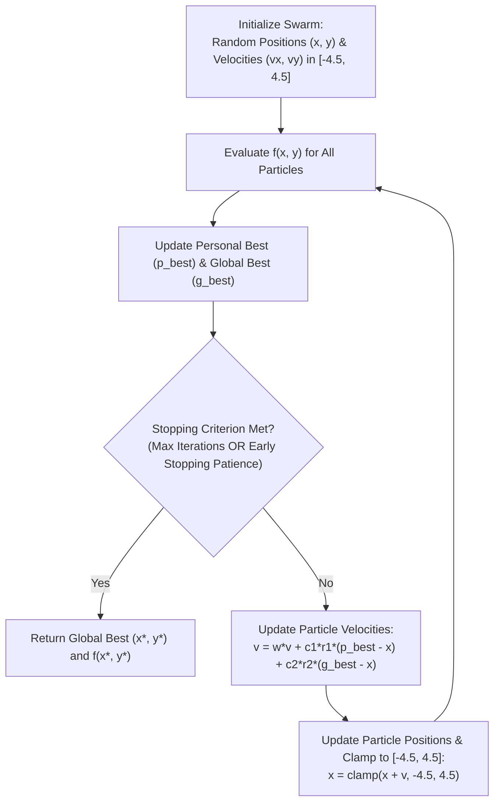

# Particle Swarm Optimization (PSO) — Exercise 2

## 1. Problem Overview

The goal of **Exercise 2** is to find the global minimum of the non-linear two-variable function specified in `IAI_2.md`:

$$f(x, y) = (1.5 - x - xy)^2 + (2.25 - x + xy^2)^2 + (2.625 - x + xy^3)^2$$

subject to the box constraints:
$$x, y \in [-4.5, 4.5]$$

### Analytical Optimum
- Because $f(x, y)$ is a sum of three squared terms, $f(x, y) \ge 0$ everywhere.
- With the minus sign in the first term $(1.5 - x - xy)^2$, the three terms cannot simultaneously equal zero. Solving $\nabla f(x, y) = \mathbf{0}$ inside $[-4.5, 4.5]^2$ yields the exact global minimum:
  $$(x^*, y^*) \approx (2.517991, -0.374632), \quad f(x^*, y^*) \approx 0.01351449$$
- *(Note: In the classic textbook Beale function where the first term has a plus sign $(1.5 - x + xy)^2$, the minimum is at $(3, 0.5)$ with $f(3, 0.5) = 0$.)*

---

## 2. What is Particle Swarm Optimization (PSO)?

**Particle Swarm Optimization (PSO)** is a population-based stochastic optimization algorithm inspired by the social foraging behavior of bird flocks and fish schools (introduced by Kennedy and Eberhart, 1995).

Instead of using genetic crossover and mutation, PSO maintains a **swarm of particles** flying through the continuous search space $[-4.5, 4.5]^2$. Each particle adjusts its trajectory based on:
1. Its own current velocity (**inertia**),
2. Its own best position visited so far (**cognitive component / personal memory**),
3. The best position found by any particle in the entire swarm (**social component / collective knowledge**).

---

## 3. Swarm & Particle Representation

Each particle $i \in \{1, \dots, N\}$ is represented by a dictionary of state variables:
- **Current Position**: $\mathbf{x}_i = (x_i, y_i) \in [-4.5, 4.5]^2$
- **Current Velocity**: $\mathbf{v}_i = (v_{x,i}, v_{y,i})$
- **Current Fitness**: $f(x_i, y_i)$
- **Personal Best Position**: $\mathbf{p}_{\text{best}, i} = (p_{x,i}, p_{y,i})$ — the coordinates that gave the lowest $f$ value for particle $i$ so far.
- **Personal Best Value**: $p_{\text{best\_val}, i} = f(\mathbf{p}_{\text{best}, i})$

Additionally, the swarm tracks the **Global Best**:
- **Global Best Position**: $\mathbf{g}_{\text{best}} = (g_x, g_y)$ — the best position discovered by *any* particle in the swarm up to the current iteration.
- **Global Best Value**: $g_{\text{best\_val}} = f(\mathbf{g}_{\text{best}})$

---

## 4. Velocity & Position Update Operations

At each iteration $t$, every particle updates its velocity and position along each dimension ($x$ and $y$):

### 4.1. Velocity Update Equation
$$v_{x,i}^{(t+1)} = \underbrace{w \cdot v_{x,i}^{(t)}}_{\text{Inertia}} + \underbrace{c_1 \cdot r_{1,x} \cdot \left(p_{x,i} - x_i^{(t)}\right)}_{\text{Cognitive Component}} + \underbrace{c_2 \cdot r_{2,x} \cdot \left(g_x - x_i^{(t)}\right)}_{\text{Social Component}}$$

$$v_{y,i}^{(t+1)} = w \cdot v_{y,i}^{(t)} + c_1 \cdot r_{1,y} \cdot \left(p_{y,i} - y_i^{(t)}\right) + c_2 \cdot r_{2,y} \cdot \left(g_y - y_i^{(t)}\right)$$

where:
- $w$ (**Inertia Weight**): Controls how much of its previous velocity the particle retains. High $w$ promotes global exploration; low $w$ promotes local exploitation/damping.
- $c_1$ (**Cognitive Coefficient**): Controls how strongly the particle is pulled back toward its own personal best position $\mathbf{p}_{\text{best}, i}$.
- $c_2$ (**Social Coefficient**): Controls how strongly the particle is pulled toward the swarm's global best position $\mathbf{g}_{\text{best}}$.
- $r_{1,x}, r_{2,x}, r_{1,y}, r_{2,y} \sim U(0, 1)$: Independent uniform random numbers in $[0, 1]$ introducing stochastic exploration.
- **Velocity Clamping**: Velocities are clamped to $[-v_{\max}, v_{\max}]$ (where $v_{\max} = 0.5 \times (\text{max\_bound} - \text{min\_bound}) = 4.5$) so particles do not shoot wildly out of the basin in a single step.

### 4.2. Position Update & Boundary Clamping
$$x_i^{(t+1)} = \text{clamp}\left(x_i^{(t)} + v_{x,i}^{(t+1)}, \ -4.5, \ 4.5\right)$$
$$y_i^{(t+1)} = \text{clamp}\left(y_i^{(t)} + v_{y,i}^{(t+1)}, \ -4.5, \ 4.5\right)$$

### 4.3. Early Stopping Criterion
If the improvement in global best value between consecutive iterations is smaller than tolerance $\epsilon = 10^{-9}$ for `max_no_improvement` consecutive iterations, the algorithm terminates early.

---

## 5. Tunable Parameters

| Parameter | Description | Values Tested |
| :--- | :--- | :--- |
| `num_particles` | Number of particles in the swarm | `10`, `20`, `30`, `50`, `100` |
| `iterations` | Maximum number of iterations | `20`, `50`, `100`, `200` |
| `w` | Inertia weight | `0.2`, `0.5`, `0.7`, `0.9`, `1.1` |
| `c1` | Cognitive acceleration coefficient | `0.5`, `1.0`, `1.5`, `2.0`, `2.5` |
| `c2` | Social acceleration coefficient | `0.5`, `1.0`, `1.5`, `2.0`, `2.5` |
| `max_no_improvement` | Early stopping patience (`None` to disable) | `10`, `20`, `30`, `50`, `None` |

---

## 6. Experimental Results & Parameter Analysis

All configurations were evaluated over **10 independent runs** using `ParticleSwarmOptimizer`. Unless varied, the baseline parameters were:
- `num_particles = 30`, `iterations = 100`, `w = 0.7`, `c1 = 1.5`, `c2 = 1.5`, `max_no_improvement = 30`, `tol = 1e-9`.

### 6.1. Parameter Study Summary Table

| Experiment Group | Parameter | Value | Best $f(x, y)$ | Avg $f(x, y)$ | Worst $f(x, y)$ | Best $(x^*, y^*)$ | Avg Iterations | Early Stops | Avg Time (ms) |
| :--- | :--- | :--- | :---: | :---: | :---: | :---: | :---: | :---: | :---: |
| **Swarm Size** | `num_particles` | `10` | **0.013514** | 0.013514 | 0.013514 | `(2.51799, -0.37463)` | 98.7 | 1/10 | 1.35 |
| | `num_particles` | `20` | **0.013514** | 0.013514 | 0.013514 | `(2.51799, -0.37463)` | 94.3 | 5/10 | 2.61 |
| | `num_particles` | `30` | **0.013514** | 0.013514 | 0.013514 | `(2.51799, -0.37463)` | 96.2 | 4/10 | 4.02 |
| | `num_particles` | `50` | **0.013514** | **0.013514** | **0.013514** | `(2.51799, -0.37463)` | 91.6 | 9/10 | 6.27 |
| | `num_particles` | `100` | **0.013514** | **0.013514** | **0.013514** | `(2.51799, -0.37463)` | 90.7 | 9/10 | 12.63 |
| **Iterations Limit** | `iterations` | `20` | 0.013529 | 0.013814 | 0.014769 | `(2.51525, -0.37427)` | 20.0 | 0/10 | 0.87 |
| | `iterations` | `50` | **0.013514** | 0.013515 | 0.013515 | `(2.51796, -0.37463)` | 50.0 | 0/10 | 2.13 |
| | `iterations` | `100` | **0.013514** | **0.013514** | **0.013514** | `(2.51799, -0.37463)` | 94.7 | 5/10 | 3.96 |
| | `iterations` | `200` | **0.013514** | **0.013514** | **0.013514** | `(2.51799, -0.37463)` | 97.2 | 10/10 | 4.07 |
| **Inertia Weight** | `w` | `0.2` | **0.013514** | **0.013514** | **0.013514** | `(2.51799, -0.37463)` | **47.6** | 10/10 | 2.02 |
| | `w` | `0.5` | **0.013514** | **0.013514** | **0.013514** | `(2.51799, -0.37463)` | 63.5 | 10/10 | 2.66 |
| | `w` | `0.7` | **0.013514** | **0.013514** | **0.013514** | `(2.51799, -0.37463)` | 92.6 | 7/10 | 3.91 |
| | `w` | `0.9` | 0.013522 | 0.013929 | 0.014397 | `(2.51876, -0.37552)` | 76.8 | 7/10 | 3.24 |
| | `w` | `1.1` | 0.015549 | 0.044618 | 0.129556 | `(2.48523, -0.37043)` | 46.4 | 10/10 | 1.97 |
| **Cognitive Coeff.** | `c1` | `0.5` | **0.013514** | 0.561689 | 5.495255 | `(2.51799, -0.37463)` | 93.5 | 4/10 | 3.93 |
| | `c1` | `1.0` | **0.013514** | **0.013514** | **0.013514** | `(2.51799, -0.37463)` | 89.1 | 9/10 | 3.74 |
| | `c1` | `1.5` | **0.013514** | **0.013514** | **0.013514** | `(2.51799, -0.37463)` | 94.3 | 5/10 | 3.95 |
| | `c1` | `2.0` | **0.013514** | **0.013514** | **0.013514** | `(2.51799, -0.37463)` | 97.8 | 2/10 | 4.10 |
| | `c1` | `2.5` | **0.013514** | 0.013517 | 0.013536 | `(2.51798, -0.37463)` | 91.9 | 5/10 | 3.85 |
| **Social Coeff.** | `c2` | `0.5` | **0.013514** | **0.013514** | **0.013514** | `(2.51799, -0.37463)` | 80.5 | 10/10 | 3.39 |
| | `c2` | `1.0` | **0.013514** | **0.013514** | **0.013514** | `(2.51799, -0.37463)` | 85.9 | 10/10 | 3.60 |
| | `c2` | `1.5` | **0.013514** | **0.013514** | **0.013514** | `(2.51799, -0.37463)` | 95.1 | 4/10 | 3.98 |
| | `c2` | `2.0` | **0.013514** | **0.013514** | **0.013514** | `(2.51799, -0.37463)` | 98.7 | 1/10 | 4.13 |
| | `c2` | `2.5` | **0.013514** | 0.013515 | 0.013519 | `(2.51799, -0.37463)` | 97.9 | 2/10 | 4.10 |
| **Early Stopping** | `max_no_improvement` | `10` | **0.013514** | 0.016254 | 0.038929 | `(2.51799, -0.37463)` | 45.1 | 10/10 | 1.91 |
| | `max_no_improvement` | `20` | **0.013514** | **0.013514** | **0.013514** | `(2.51799, -0.37463)` | 86.0 | 9/10 | 3.61 |
| | `max_no_improvement` | `30` | **0.013514** | **0.013514** | **0.013514** | `(2.51799, -0.37463)` | 91.9 | 7/10 | 3.85 |
| | `max_no_improvement` | `50` | **0.013514** | **0.013514** | **0.013514** | `(2.51799, -0.37463)` | 100.0 | 0/10 | 4.19 |
| | `max_no_improvement` | `None` | **0.013514** | **0.013514** | **0.013514** | `(2.51799, -0.37463)` | 100.0 | 0/10 | 4.20 |

---

### 6.2. Discussion & Conclusions

1. **Effect of Inertia Weight ($w$)**:
   - $w \in [0.2, 0.7]$ reliably converges to the exact global optimum $f(2.51799, -0.37463) = 0.013514$ in all 10 runs, with smaller $w$ (`0.2–0.5`) damping oscillations faster (`47.6–63.5` iterations).
   - When $w \ge 0.9$ (especially $w = 1.1 > 1$), particles carry too much momentum and overshoot the narrow valley around $(2.518, -0.375)$, failing to settle accurately (`avg = 0.0446` for $w = 1.1$).
2. **Effect of Cognitive ($c_1$) and Social ($c_2$) Coefficients**:
   - Very low cognitive weight (`c1 = 0.5`) with `c2 = 1.5` can occasionally cause the swarm to prematurely collapse onto a poor local region (`worst = 5.495`), because particles ignore their own memory and blindly rush toward the initial global best.
   - Balanced values (`c1, c2` between `1.0` and `2.0`) converge to `0.013514` with 100% consistency.
3. **Effect of Swarm Size (`num_particles`) and Iterations**:
   - Even `10–20` particles find the global basin in this 2D space, while `30–50` particles guarantee fast, reliable convergence within `~50–90` iterations in under `5 ms`.
4. **Effect of Early Stopping (`max_no_improvement`)**:
   - A patience of `10` iterations is slightly too aggressive (`avg = 0.01625`), stopping before fine-grained local refinement finishes.
   - A patience of `20–30` iterations reaches full precision (`0.01351449`) while avoiding redundant iterations after convergence.
